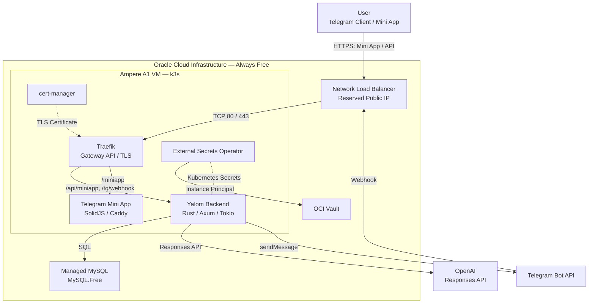
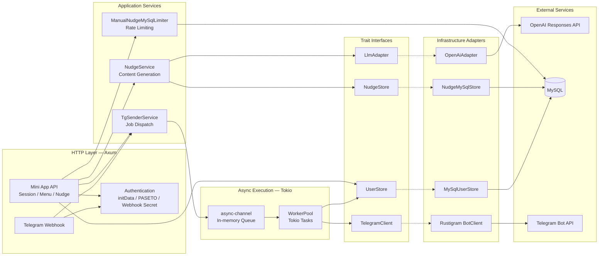
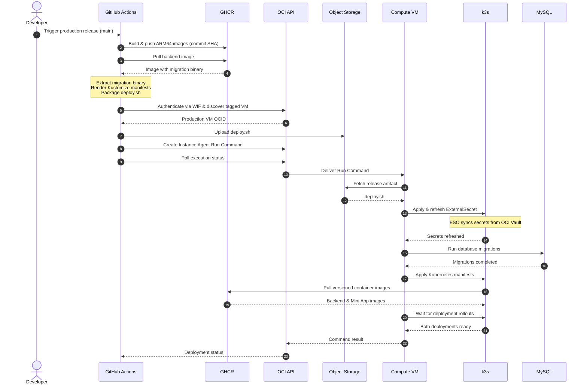

# Yalom

**Small interruptions to everyday autopilot.**

Yalom is a Telegram bot built around a simple idea: to offer small opportunities to see familiar things differently.

These opportunities come in the form of short, text-based insights that users can request on demand through a Telegram Mini App.

*Note: Yalom currently supports Russian only.*

[Try Yalom on Telegram](https://t.me/at_least_something_bot)

## Features

- **On-demand nudges** — Request short messages anytime through the Telegram Mini App.
- **LLM-generated and curated content** — Messages are either generated by an LLM or selected from a hand-made collection.
- **Rate limiting** — Cooldown and daily limits for on-demand requests.

### Planned

- **User settings** — Manage your profile, time zone, and pause settings.
- **Agent mode** — Yalom autonomously decides when to reach out, instead of waiting for a request.
- **Feedback** — React to received messages and build a history of interactions.
- **Personalization** — Adapt message content to individual preferences and previous interactions.

## Tech Stack

**Backend**

Rust (Tokio, Axum), SQLx, async-channel, tracing. Asynchronous HTTP API, background workers.

**Frontend**

SolidJS 2, TypeScript (TSRX), TanStack Router & Query, UnoCSS, Vite.

**Database**

MySQL with SQLx migrations. OCI MySQL Free DB System in production.

**Integrations**

Telegram Bot API, Telegram Mini Apps, and OpenAI Responses API.

**Infrastructure**

Oracle Cloud Infrastructure (OCI Always Free): Ampere A1 Compute, Network Load Balancer, MySQL, Vault, and Object Storage. IAM policies, Dynamic Groups, and workload identity federation manage access between services and CI/CD.

**Deployment**

Single-node k3s cluster with Traefik, Gateway API, cert-manager, and External Secrets Operator. Kustomize assembles Kubernetes manifests from a shared base and environment-specific overlays.

**CI/CD**

GitHub Actions for automated tests, linting, builds, and release workflows. ARM64 container images are published to GHCR, with deployment to OCI through Instance Agent Run Command, including database migrations and Kubernetes rollouts.

**Developer Experience**

A Justfile provides a unified interface for local development, database migrations, testing, and validation. Docker Compose runs the backend, Mini App, and MySQL locally.

## Architecture

### System Overview

Yalom runs on a single-node k3s cluster hosted on OCI Always Free. An OCI Network Load Balancer routes incoming traffic through Traefik to the Rust backend and Telegram Mini App.

The backend integrates with Telegram, OpenAI, and a managed MySQL database. Secrets are provided by OCI Vault through the External Secrets Operator.

System Overview — C4 Container View

### Backend Components

The Rust backend follows a layered architecture: Axum handles HTTP requests, application services coordinate business logic, and trait-based interfaces separate core functionality from external integrations.

Dependencies are composed at startup through Rust generics and `AppState`. Trait-based boundaries allow services to be tested with lightweight fakes, while SQLx integration tests verify persistence against a real MySQL database.

Backend Components — C4 Component View

### CI/CD Pipeline

CI runs on pull requests, validating Rust and frontend code, integration tests, container builds, and Kubernetes manifests. Production releases are manually triggered from `main` and deployed through OCI Instance Agent Run Command, without direct SSH access.

CI/CD — Release Sequence

## Development

Local development is managed through [Just](https://github.com/casey/just) and Docker Compose.

After configuring `local/.env` from `local/.env.example`:

- `just dev-up` — Start the local environment and apply migrations.
- `just migration <name>` — Create a new database migration.
- `just migrate` — Apply database migrations.
- `just test` — Run Rust tests with an isolated MySQL instance.
- `just check` — Run formatting, linting, tests, and Kubernetes/frontend checks.
- `just tunnel` — Expose the local environment through Cloudflare Tunnel.
- `just telegram-setup` — Configure the Telegram webhook and Mini App.
- `just dev-down` — Stop the local environment.

See the [justfile](justfile) for all available commands.

## Design Decisions & Trade-offs

- **In-memory job processing** — Telegram updates and outgoing messages are handled by a Tokio worker pool with an in-memory channel. This keeps the architecture simple, but jobs are not persisted or retried. Message delivery is best-effort, with no exactly-once guarantees. A successful API response confirms enqueueing, not delivery.

- **Single-node Kubernetes** — k3s runs on a single OCI Compute instance, prioritizing simplicity and low operational overhead over high availability.

- **OCI Always Free** — Infrastructure is designed to operate within OCI's free resource limits, trading scalability and availability for minimal operating costs.